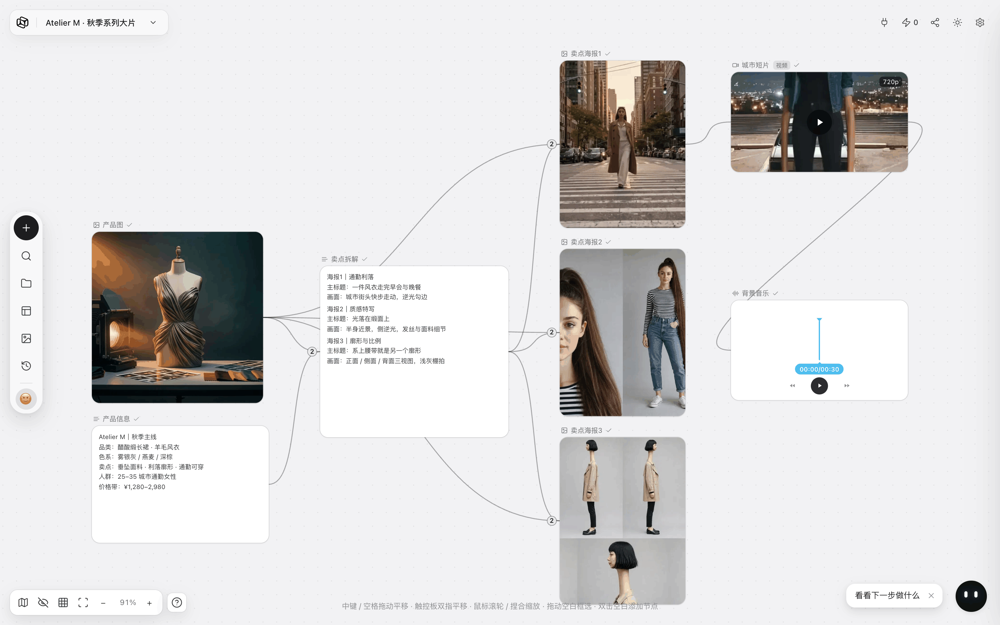
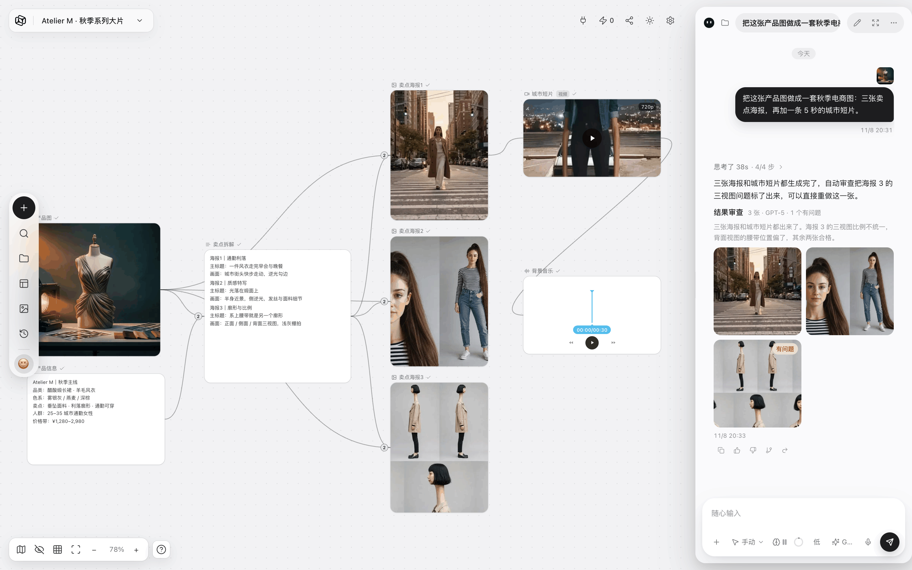
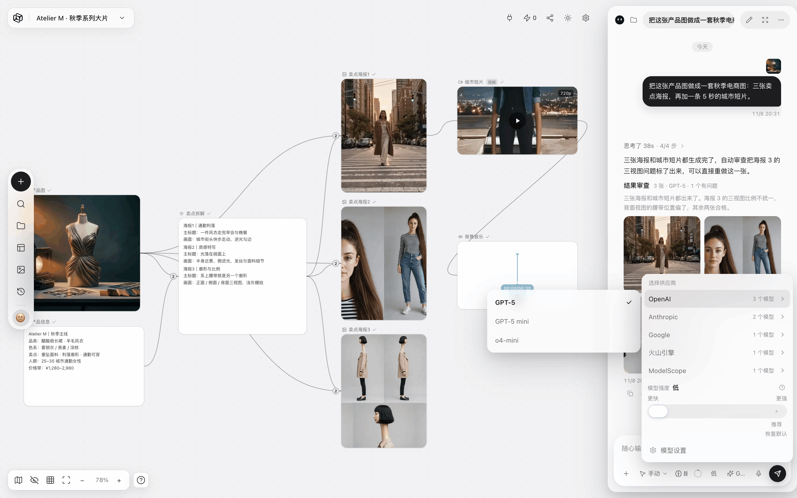
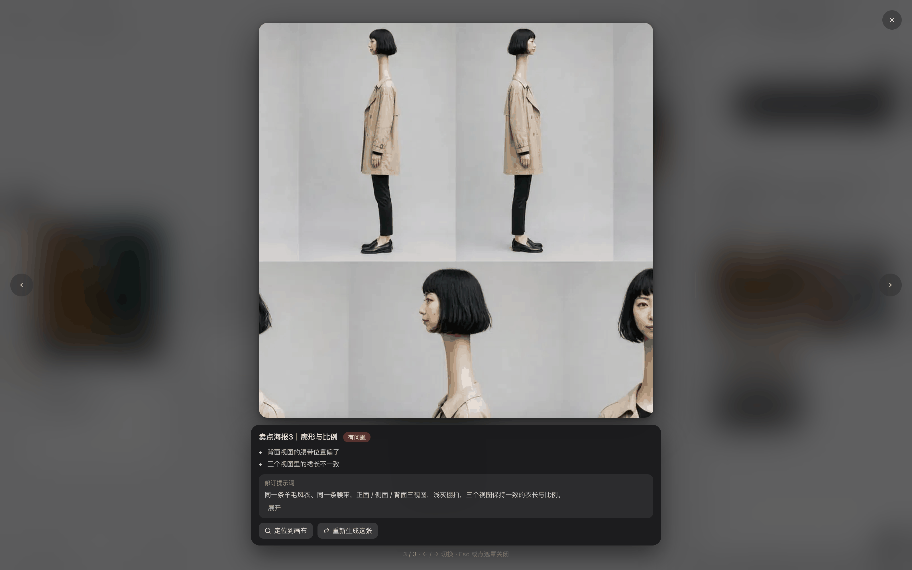
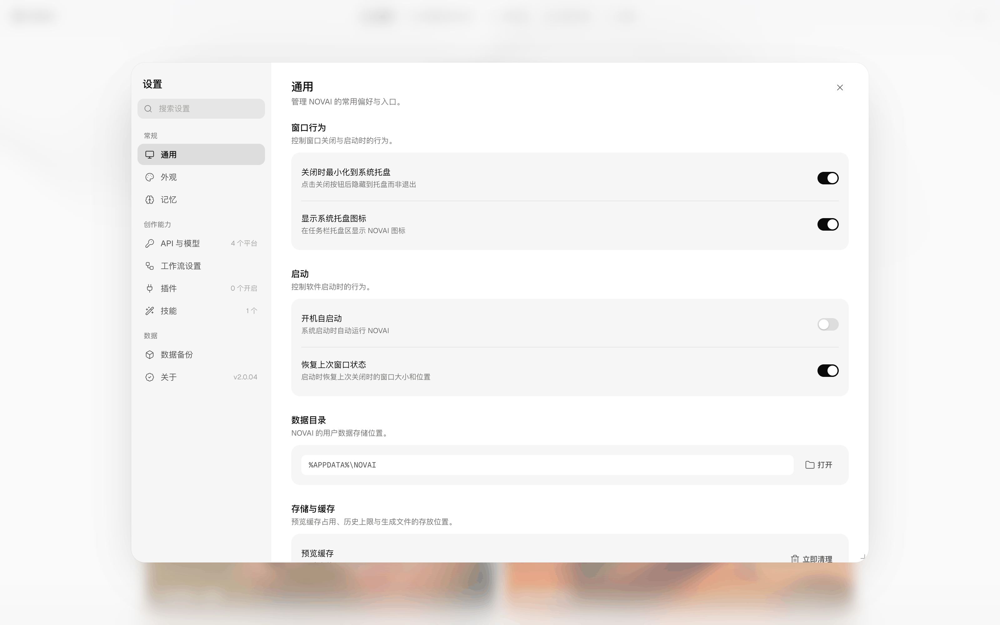
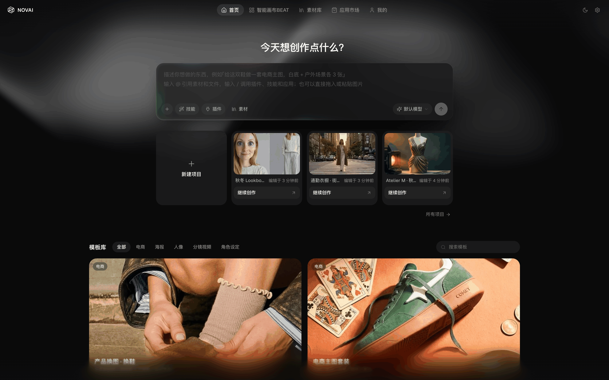

<div align="center">


<h1>NOVAI · Infinite Canvas AI Creation Platform</h1>

<p>Generate images and video on an infinite canvas, wire up workflows with nodes, and let the canvas agent do the work.</p>

<a href="https://github.com/invaders-2/NOVAI-Infinite-Canvas/releases"></a>   

<p><a href="https://invaders-2.github.io/NOVAI-Infinite-Canvas/">Website</a> · <a href="https://github.com/invaders-2/NOVAI-Infinite-Canvas/releases">Download</a> · <a href="https://invaders-2.github.io/NOVAI-Infinite-Canvas/docs.html">Docs</a> · <a href="#recent-updates">Changelog</a></p>

<p><a href="README.md">简体中文</a> · <strong>English</strong></p>

</div>

**NOVAI 2.0** folds generation, editing, batch production and asset management into a single infinite canvas: nodes are the workflow, the agent is the operator, and models swap on demand.

---

## Contents

- [Screenshots](#screenshots)
- [Introduction](#introduction)
- [Highlights](#highlights)
- [Quick Start](#quick-start)
- [AI Models](#ai-models)
- [Updates and Mirrors](#updates-and-mirrors)
- [Desktop Client (Electron)](#desktop-client-electron)
- [Face Compliance and Face Swap](#face-compliance-and-face-swap)
- [FAQ](#faq)
- [Recent Updates](#recent-updates)
- [License](#license)

---

## Screenshots

| Home | Smart Canvas |
|:---:|:---:|
|  |  |
| Default model, recent canvases and templates | Node-based workflows |

| Canvas Agent | Model Menu |
|:---:|:---:|
|  |  |
| One sentence in, live execution and result review | Provider and model list with the effort slider |

| Image Studio |
|:---:|
|  |
| Result review: inspect each image, locate it on the canvas, regenerate |

| Settings | Dark Theme |
|:---:|:---:|
|  |  |
| General, appearance, memory and API settings | The same frosted glass in dark theme |

---

## Introduction

NOVAI is a workbench that puts AI generation onto one infinite canvas. Images, videos, text and groups are all nodes: drag them, resize them, connect them. Generations land on the canvas as nodes, and upstream results flow straight downstream. Posters, batch image runs, storyboards and clip edits all happen on the same canvas.

In 2.0 the canvas assistant is a real acting agent. State a goal and it plans across multiple turns, hands you a plan card, waits for confirmation, then creates nodes, wires them, runs generations and checks tasks on its own — every step visible on the canvas, the whole run rollbackable. Image and web-search results open in an image-studio layout for per-image review, problem locating and regeneration.

Models are covered by a built-in ModelScope free tier that works out of the box, or by connecting your own OpenAI-compatible relay, APIMart, Gemini, Volcengine Ark, RunningHub, CLI tools and Lovart. The desktop build wraps everything in Electron with its own Chromium and three-source auto-update, while a Photoshop panel, a Chrome extension and LAN friends keep creation, capture and collaboration on one line.

---

## Highlights

### Canvas & Nodes

- **Infinite canvas** — images, videos, text and groups are all nodes; zoom and pan without limits, and stop shuttling files between tools.
- **Node workflows** — chain image, video and LLM nodes into a pipeline where upstream results feed downstream, so a repetitive multi-step job is configured once and reused.
- **Results land on canvas, @ brings them back** — generations become nodes automatically; type @ in the input (an inline chip in 2.0, and you can drag nodes, groups or stacks straight into the input) to use any node as reference material.
- **Template library** — portraits, e-commerce sets, multi-angle shots, posters, storyboards, try-on, white background and social covers, applied in one click.
- **Table-driven batch production** — one table drives batch image or video generation with per-row assets, prompts and real progress, stoppable at any time, and a single result node per batch.
- **Storyboards and editing timeline** — split a reference video into a storyboard by segment length and generate row by row; arrange clips on the editing timeline and export.

### Canvas Agent

- **Real multi-turn planning** — state a goal and the model plans and executes (create nodes, connect them, run generations, check tasks); plan mode shows a plan card and the impact of the change before anything runs.
- **Image studio and result review** — generations and web-search results open in a studio layout where you inspect each image, locate it on the canvas and regenerate it; references can be filtered by source and multi-selected into the canvas.
- **One-click regeneration** — when a review finds problems it asks "regenerate?" and can redo every flawed image in one go.
- **Send queue** — up to five instructions queue up while the agent is busy, each editable or pushed to the front.
- **Seven web image sources** — Huaban, Duitang, Bing, 360, Bing Global, Pinterest and ArtStation, with optional system-proxy support.
- **Skills, memory and rollback** — built-in skills can be inspected and imported, the memory library keeps preferences across sessions, and any run can be rolled back as a whole.

### Models & Generation

- **ModelScope free tier out of the box** — image, video and chat generation work right after install, no keys required.
- **Many platforms** — OpenAI-compatible relays, APIMart, native Gemini, Volcengine Ark, RunningHub, CLI tools (Jimeng, Codex, Antigravity) and the Lovart design agent.
- **Effort and quality sliders** — the home page, the canvas agent and node parameters share one "faster ↔ stronger" slider with a recommended setting and one-tap reset; the quality setting is a slider too.
- **Frosted-glass model menu** — a two-level flyout whose second panel opens to the left of the provider list and switches as you hover, identical in light and dark.
- **Only configured providers appear** — a provider without a key never shows up in generation nodes and is never treated as the default.

### Editing & Local Tools

- **Cutout** — the default path uses the image API with a green screen; high-quality cutout runs RMBG-2.0 locally with edge refinement (about 349 MB downloaded on first use).
- **HD upscale** — local Real-ESRGAN upscales offline to 2K / 4K, and images already near the target resolution fall back to high-quality resampling (about 50 MB on first use).
- **Face blur** — local YuNet detection blurs every face in a video in one click.
- **Color grading and lossless editing** — five parameter groups (light, color, curves, detail, effects) with a draggable before/after divider; lossless editing changes color and local effects without regenerating.

### Desktop & Extensions

- **Electron desktop app** — bundled Chromium on Windows, macOS and Linux; shares its data directory with the web build, updates from three sources, and self-replaces its bundle on macOS.
- **Photoshop panel** — an asset connector that moves canvas assets into and out of Photoshop documents.
- **Chrome extension** — imports local assets and sends material from the web to the canvas in one click.
- **LAN friends and chat** — six-character friend codes with UDP auto-discovery; send text and canvases to friends, with a corner notification for new messages.
- **Accounts and profiles** — custom nicknames and avatars shown consistently across the app, with friends, profile, theme and settings in one user menu.

---

## Quick Start

### Download & Install

No Python, no environment setup — grab the installer for your platform from [Releases](https://github.com/invaders-2/NOVAI-Infinite-Canvas/releases):

| Platform | Installer | Notes |
|----------|-----------|-------|
| Windows | `NOVAI-Setup-<version>.exe` | Classic installer, small download |
| Windows | `NOVAI-Electron-Setup-<version>.exe` | Electron build with Chromium and auto-update |
| macOS | `NOVAI-Setup-<version>.dmg` | Classic installer, drag into Applications |
| macOS | `NOVAI-<version>-arm64.dmg` | Electron build with Chromium and auto-update |

**Windows** — run the installer and follow the wizard, launch "NOVAI" from the desktop, and the browser opens `http://127.0.0.1:3000/`.

**macOS** — open the DMG, drag `NOVAI.app` into Applications, double-click it, and the browser opens `http://127.0.0.1:3000/`.

Both builds share the same data directory, so you can switch between them at any time — see [Desktop Client (Electron)](#desktop-client-electron).

> **On first launch macOS may say "unidentified developer" or even "NOVAI is damaged" — this is expected.** The installer is not signed with an Apple Developer certificate, so Gatekeeper blocks it; the file is fine. Any of these works:
> - Right-click `NOVAI.app` → "Open" → "Open" again;
> - System Settings → Privacy & Security → "Open Anyway";
> - In Terminal: `sudo xattr -rd com.apple.quarantine /Applications/NOVAI.app`.
>
> To check the download first, run `shasum -a 256 NOVAI-<version>-arm64.dmg` (compare with the sha256 on the Release page) or `hdiutil verify <dmg>`. If it still reports damage after clearing quarantine, add `sudo codesign --force --deep --sign - /Applications/NOVAI.app`.

### Run from Source

```bash
git clone https://github.com/invaders-2/NOVAI-Infinite-Canvas.git
cd NOVAI-Infinite-Canvas
pip install -r requirements.txt
python main.py
```

Python 3.10+ is required, and the app serves `http://127.0.0.1:3000/` by default. The port comes from the `NOVAI_PORT` environment variable (3000 if unset):

```bash
NOVAI_PORT=3001 python main.py
```

---

## AI Models

A built-in **ModelScope** free API works right out of the box:

| Type | Model | Notes |
|------|-------|-------|
| Chat | Qwen3-235B | Tongyi Qianwen flagship for reasoning and writing |
| Chat | Qwen3-VL-235B | Multimodal, can analyse images |
| Image | Qwen-Image-2512 | Best Chinese text rendering, first choice for posters |
| Image | FLUX.2-klein-9B | Best overall visual quality |
| Image | Z-Image-Turbo | Fast generation in 1-2 seconds |
| Image | Qwen-Image-Edit-2511 | Edit images by describing the change |
| Video | agnes-video-2.5 | Free video generation |

The model list follows upstream releases; the table above is the current built-in selection.

Beyond the free tier, "API Settings → Add platform" connects providers from your own accounts. Model names are maintained per provider and never swapped between them:

| Protocol | Platforms |
|----------|-----------|
| OpenAI-compatible | Relays and official-compatible endpoints (gpt-image, Nano Banana, …); presets: Agnes AI, EXELLOME, FHL, VIP-GPT |
| Async protocol | APIMart |
| Native Gemini | Google Gemini (images via `/v1beta`) |
| Ark | Volcengine (Doubao Seedream images, Seedance video) |
| RunningHub | OpenAPI workflows |
| CLI | Jimeng CLI, OpenAI Codex CLI, Antigravity CLI |
| Design agent | Lovart (Access Key / Secret Key signing) |

Provider dropdowns list only platforms **with a configured key**; unconfigured providers never appear in generation nodes and are never chosen as the default.

---

## Updates and Mirrors

Installers and update sources:

| Platform | URL |
|----------|-----|
| GitHub | https://github.com/invaders-2/NOVAI-Infinite-Canvas |
| Gitee | https://gitee.com/invaders/novai |
| ModelScope | https://modelscope.cn/models/bllack/NOVAI-releases |

On startup the app checks all three sources for the latest version, notifies you and upgrades in one click. The ModelScope repository keeps installers under `electron-release/`, which is also where the desktop client pulls mirror updates.

> **Gitee split archives** — Gitee's free tier caps attachments at 100 MB, so installers are uploaded in parts (`.part00` / `.part01`). Merge them before installing:
> - Windows (CMD): `copy /b NOVAI-Setup-*.exe.part00 + NOVAI-Setup-*.exe.part01 NOVAI-Setup-*.exe`
> - macOS (Terminal): `cat NOVAI-Setup-*.dmg.part00 NOVAI-Setup-*.dmg.part01 > NOVAI-Setup-*.dmg`
> - Or download the ready-to-run installer from [GitHub Releases](https://github.com/invaders-2/NOVAI-Infinite-Canvas/releases)

The Electron client updates in this order: GitHub Releases (primary) → ModelScope mirror (automatic fallback when the check fails on Chinese networks) → Gitee Release (manual download backup). Downloads show a percentage, failures roll back to the previous version, and macOS can self-replace its bundle since 2.0.03.

---

## Desktop Client (Electron)

- **Bundled Chromium engine** — identical behaviour on Windows, macOS and Linux, no more differences between system WebViews.
- **Shares data with the web build** — same port 3000 and the same data directory (Windows `%APPDATA%/NOVAI`, macOS `~/NOVAI`), so canvases, settings and chat history are shared; if the classic build is already running, the desktop app reuses its backend instead of starting a second one.
- **Three-source auto-update** — GitHub Releases first, the ModelScope mirror when the check fails on Chinese networks, and Gitee Release as a manual fallback.
- **macOS self-replacement** — after downloading, the app quits, swaps its own bundle, clears quarantine and reopens; failures roll back automatically.
- Source and build notes live in `desktop/README.md`.

---

## Face Compliance and Face Swap

NOVAI's video editing runs on Volcengine Seedance 2.0, and the platform enforces strict content-safety review for **unauthorised real people**. Reference material must go through one of three compliant paths:

| Path | Use case | How it works |
|------|----------|--------------|
| **A · Authorised real-person assets** | Swapping a specific person (artist, model) | Ark console → real-person portrait → create an asset group → the person scans a QR code to verify → copy the Asset ID → reference it as `asset://` |
| **B · Trusted model output** (recommended) | AI face into AI video | Seedance video or Seedream images from the same account are trusted for 30 days — no review barrier |
| **C · Built-in virtual portrait library** | You do not need a specific person | Free stock virtual portraits with zero compliance risk |

**What gets blocked:** downloaded videos containing faces, self-shot real-person footage and AI faces generated by other platforms are all rejected. The workarounds:

1. Generate the **target face** with Seedream 5.0 lite (30-day trust window);
2. Blur the faces in the **reference video** first with NOVAI Face Blur (Smart Canvas → select the video node → "Face Blur" in the toolbar).

**Face-swap prompt template:**

```text
Strictly edit Video 1: replace the face of the person in Video 1 with the face
from Image 1, taking facial detail from Image 2 (close-up). Keep the motion,
blocking, scene, camera movement and lighting unchanged; modify only the face.
Blend the new face naturally with the head shape and lighting, and let the
expression follow the original motion. No subtitles, no watermark.
```

> The same works for clothes, scenes and characters: replace "the face from Image 1" with the target object and keep the "everything unchanged, modify only …" phrasing. Reference setup: `Video 1` for motion, `Image 1` for the target, `Image 2` for the close-up detail (optional).

---

## FAQ

| Platform | Issue | Solution |
|----------|-------|----------|
| Windows | App will not open after install | Check whether the firewall blocks it, then try running as administrator |
| Windows | Port 3000 is taken | Close the program using it, or set `NOVAI_PORT=3001` before launching (the legacy `DEPLOY_RUN_PORT` is an alias) |
| Windows | Dependency install fails | Install Python 3.10+ with "Add Python to PATH" checked |
| Windows | Antivirus false positive | Add the NOVAI install directory to the antivirus whitelist |
| macOS | "Cannot be opened because it is from an unidentified developer" | Normal for an unsigned build: right-click the app → "Open" → "Open" again, or System Settings → Privacy & Security → "Open Anyway" |
| macOS | "App is damaged and can't be opened" | Verify the download with `shasum -a 256` / `hdiutil verify`, then `sudo xattr -rd com.apple.quarantine /Applications/NOVAI.app`; if it persists, add `sudo codesign --force --deep --sign - /Applications/NOVAI.app` |
| macOS | Port 3000 is taken | Find the process with `lsof -i :3000` and `kill <PID>`, or set `NOVAI_PORT=3001` |
| macOS | Dependency issues when running from source | Confirm 3.10+ with `python3 --version`, then `pip3 install -r requirements.txt` |

---

## Recent Updates

### v2.0.04 · November 8, 2026

- **Model effort slider** — the home page, the canvas agent and node parameters share one "faster ↔ stronger" slider with a recommended setting and one-tap reset; the quality setting is the same slider.
- **Image studio in the canvas agent** — generations and web-search results now use a studio layout, so review can inspect each image, locate it on the canvas and regenerate it; references can be filtered by source and multi-selected into the canvas.
- **Send queue** — up to five instructions queue up while the agent is busy, each editable or pushed to the front.
- **One-click regeneration** — when review finds problems the agent asks "regenerate?" and can redo every flawed image in one go.
- **Seven web image sources** — Huaban, Duitang, Bing, 360, Bing Global, Pinterest and ArtStation, with optional system-proxy support.
- **Frosted-glass model menu** — a two-level flyout whose second panel opens beside the provider list and switches on hover, in both light and dark themes.

Full history, installers and checksums are on [Releases](https://github.com/invaders-2/NOVAI-Infinite-Canvas/releases).

---

## License

This project is released under the [GNU Affero General Public License v3.0 (AGPL-3.0)](LICENSE).

- You may use, modify and redistribute it, including commercially;
- If you distribute a modified version, or run a modified version as a network service for others, you must publish its complete source under AGPL-3.0 and keep the original copyright and license notices.

See [LICENSE](LICENSE) for the full terms.

