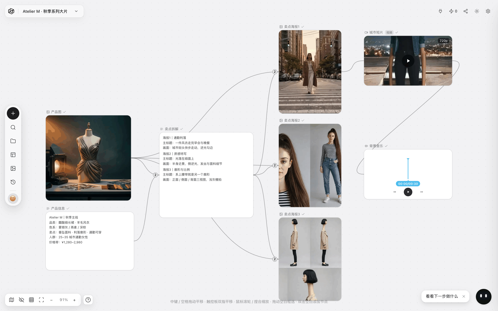
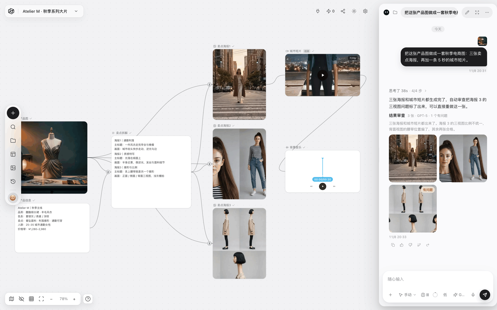
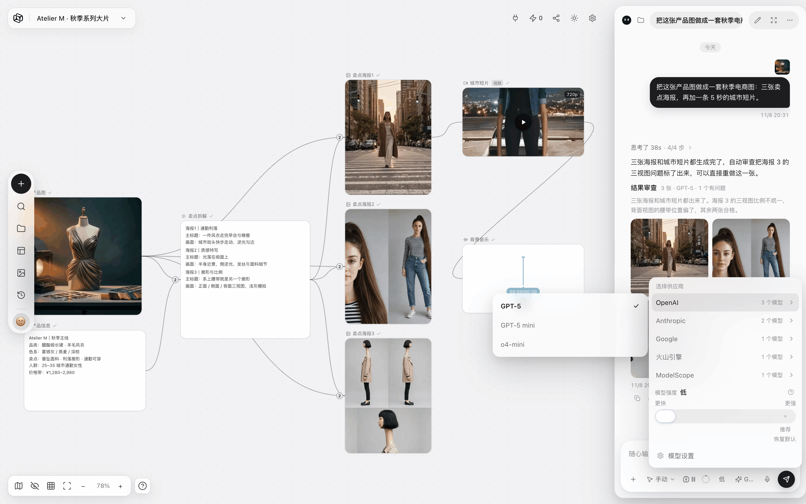
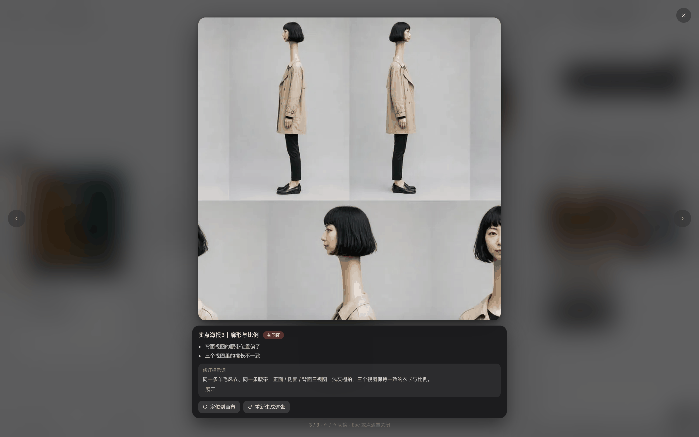
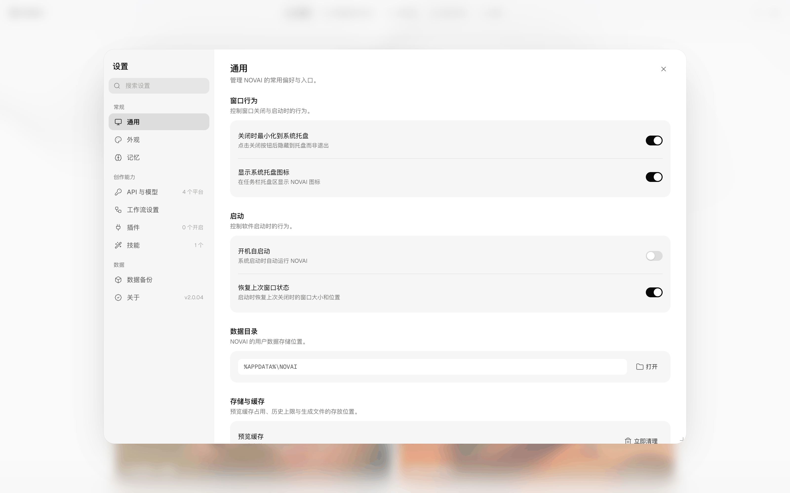

<div align="center">


<h1>NOVAI · 无限画布 AI 创作平台</h1>

<p>在无限画布上生成图片与视频，用节点串联工作流；画布助手一句话就能自己规划并动手。</p>

<a href="https://github.com/invaders-2/NOVAI-Infinite-Canvas/releases"></a>   

<p><a href="https://invaders-2.github.io/NOVAI-Infinite-Canvas/">官网</a> · <a href="https://github.com/invaders-2/NOVAI-Infinite-Canvas/releases">下载</a> · <a href="https://invaders-2.github.io/NOVAI-Infinite-Canvas/docs.html">帮助文档</a> · <a href="#最近更新">更新日志</a></p>

<p><strong>简体中文</strong> · <a href="README.en.md">English</a></p>

</div>

**NOVAI 2.0** 把生成、编辑、批量生产与素材管理收进同一张无限画布：节点即工作流，助手即执行者，模型按需切换。

---

## 目录

- [界面预览](#界面预览)
- [软件介绍](#软件介绍)
- [功能亮点](#功能亮点)
- [快速开始](#快速开始)
- [AI 模型](#ai-模型)
- [更新与镜像](#更新与镜像)
- [桌面客户端（Electron）](#桌面客户端electron)
- [人脸合规与换脸](#人脸合规与换脸)
- [常见问题](#常见问题)
- [最近更新](#最近更新)
- [许可证](#许可证)

---

## 界面预览

| 首页 | 智能画布 |
|:---:|:---:|
|  |  |
| 默认模型、最近画布与模板库 | 节点工作流 |

| 画布助手 | 模型菜单 |
|:---:|:---:|
|  |  |
| 一句话下达任务，实时执行与结果审查 | 供应商与模型列表、模型强度滑块 |

| 图片工作台 |
|:---:|
|  |
| 结果审查：逐张看问题、定位画布、重新生成 |

| 设置 | 暗色主题 |
|:---:|:---:|
|  |  |
| 通用、外观、记忆与 API 设置 | 暗色主题下的同一套磨砂玻璃 |

---

## 软件介绍

NOVAI 是一个把 AI 生成能力放进同一张无限画布的工作台。图片、视频、文本、群组都是画布上的节点：可以自由拖拽、缩放、连线，生成结果直接落成节点，上游产物自动流向下游。做海报、批量出图、做分镜、剪片段，都在这一张画布上完成。

2.0 的画布助手是一个真正会动手的 Agent。说清目标后，它会在多轮里规划步骤、给出计划卡片、等你确认，然后自己建节点、连线、跑生成、查任务；每一步都在画布上实时可见，跑完可以整体回滚。生图与搜图结果进入图片工作台版式，逐张审查、定位问题、重新生成。

模型侧内置 ModelScope 免费额度，装好即用；也可以接入自己的 OpenAI 兼容中转、APIMart、Gemini、火山方舟、RunningHub、命令行工具与 Lovart 设计代理。桌面端用 Electron 封装，自带 Chromium、支持三源自动更新；配合 Photoshop 面板、Chrome 扩展与局域网好友，创作、采集、协作串在一条线上。

---

## 功能亮点

### 画布与节点

- **无限画布**：图片、视频、文本、群组都是节点，缩放平移不限边界，不用在多个工具之间导文件。
- **节点工作流**：把图片、视频、LLM 节点连成流水线，上游结果直接喂给下游，重复的多步操作配一次、反复复用。
- **生成落画布与 @ 引用**：生成结果自动成为节点；输入框里 @ 一下（2.0 为内联胶囊，也支持把节点、群组、堆叠直接拖进输入区）即可当作参考素材。
- **模板库**：人像、电商套图、多角度、海报、分镜、试穿、白底、社交封面等模板一键套用。
- **多维表格批量生产**：一张表驱动批量出图 / 出视频，逐行素材与提示词、逐行真实进度、可随时停止，一次批量只落一个结果节点。
- **分镜表与剪辑时间线**：参考视频按每段秒数自动切成分镜表，逐行生成；片段可在剪辑时间线里排列并导出。

### 画布助手（Agent）

- **真 Agent 多轮规划**：一句话说清目标，模型自己规划步骤并执行（建节点、连线、跑生成、查任务）；计划模式会先给计划卡片与影响面，确认后再动手。
- **图片工作台与结果审查**：生图与联网搜图结果换成工作台版式，可逐张看问题、定位到画布、重新生成；参考图可按来源筛选、多选加入画布。
- **一键重生成**：审查发现不合格时直接问一句「要重新生成吗」，一键重做所有有问题的图。
- **待发送队列**：助手忙时最多排队 5 条指令，可编辑、可插队立即发送。
- **联网搜图七站**：花瓣、堆糖、必应、360、必应国际、Pinterest、ArtStation 七个来源，支持跟随系统代理。
- **技能、记忆与回滚**：内置技能集中可查、可导入，记忆库跨会话保留偏好；每次执行可整体回滚。

### 模型与生成

- **ModelScope 免费开箱**：内置免费额度，装好即可生成图片、视频与对话，不用先配 Key。
- **多平台接入**：OpenAI 兼容中转、APIMart、Gemini 原生、火山方舟、RunningHub、即梦 / Codex / Antigravity 等 CLI、Lovart 设计代理。
- **模型强度与质量滑块**：首页、画布助手、节点参数共用同一根「更快 ↔ 更强」滑块，带推荐档与一键恢复默认；「质量」档同样是滑块。
- **磨砂玻璃模型菜单**：两级浮层，二级贴在供应商左侧弹出，鼠标划过供应商直接切换，亮暗两套一致。
- **只显示已配置的平台**：没填 Key 的供应商不会出现在生成节点里，也不会被当成默认平台。

### 编辑与本地能力

- **抠图**：默认走生图 API 绿幕抠图；「高质量抠图」用本地 RMBG-2.0 离线推理 + 边缘精修（首次使用下载约 349MB 模型）。
- **HD 超分**：本地 Real-ESRGAN 离线放大到 2K / 4K，接近目标分辨率的图自动改用高质量缩放（首次使用下载约 50MB 组件）。
- **人脸模糊**：本地 YuNet 检测，一键模糊视频中的全部人脸。
- **调色与无损编辑**：光线、颜色、曲线、细节、效果五组参数，拖拽分割线对比原图；无损编辑直接改颜色与局部效果，不重新生成。

### 客户端与扩展

- **Electron 桌面端**：自带 Chromium，Windows / macOS / Linux 通用；与网页版共用数据目录，支持三源自动更新，macOS 可自替换更新。
- **Photoshop 面板**：素材连接器，画布素材与 Photoshop 文档之间直接取用。
- **Chrome 扩展**：本地素材导入，网页上的素材一键进画布。
- **局域网好友与聊天**：6 位短好友码 + UDP 自动发现，加好友后文字与画布互发，新消息右下角提醒。
- **账号与个人资料**：昵称与头像可自定义，全站统一显示；好友、资料、主题、设置集中在用户菜单。

---

## 快速开始

### 下载安装

无需安装 Python、无需配置环境。到 [Releases](https://github.com/invaders-2/NOVAI-Infinite-Canvas/releases) 按平台选择安装包：

| 平台 | 安装包 | 特点 |
|------|--------|------|
| Windows | `NOVAI-Setup-<版本>.exe` | 传统安装版，体积小 |
| Windows | `NOVAI-Electron-Setup-<版本>.exe` | Electron 版，自带 Chromium 与自动更新 |
| macOS | `NOVAI-Setup-<版本>.dmg` | 传统安装版，拖入「应用程序」 |
| macOS | `NOVAI-<版本>-arm64.dmg` | Electron 版，自带 Chromium 与自动更新 |

**Windows**：双击安装包按引导完成 → 双击桌面「NOVAI」→ 浏览器自动打开 `http://127.0.0.1:3000/`。

**macOS**：打开 DMG，把 `NOVAI.app` 拖进「应用程序」→ 双击启动 → 浏览器自动打开 `http://127.0.0.1:3000/`。

两种安装包装完共用同一份数据目录，可随时互换，详见[桌面客户端（Electron）](#桌面客户端electron)。

> **macOS 首次打开提示「未识别的开发者」或「已损坏」是正常现象**：安装包没有 Apple 开发者签名，这是 Gatekeeper 的安全拦截，不是文件损坏。任选一种处理：
> - 右键点 `NOVAI.app` →「打开」→ 再点一次「打开」；
> - 系统设置 → 隐私与安全性 → 点「仍要打开」；
> - 终端执行 `sudo xattr -rd com.apple.quarantine /Applications/NOVAI.app`。
>
> 想先确认下载完整：`shasum -a 256 NOVAI-<版本>-arm64.dmg`（对照 Release 页的 sha256）或 `hdiutil verify <dmg>`。清掉隔离后仍报「已损坏」，再补一步 `sudo codesign --force --deep --sign - /Applications/NOVAI.app`。

### 源码运行

```bash
git clone https://github.com/invaders-2/NOVAI-Infinite-Canvas.git
cd NOVAI-Infinite-Canvas
pip install -r requirements.txt
python main.py
```

要求 Python 3.10+，默认访问 `http://127.0.0.1:3000/`。端口由环境变量 `NOVAI_PORT` 控制（默认 3000）：

```bash
NOVAI_PORT=3001 python main.py
```

---

## AI 模型

内置 **ModelScope** 免费 API，装好即可使用：

| 类型 | 模型 | 说明 |
|------|------|------|
| 对话 | Qwen3-235B | 通义千问旗舰，逻辑推理 / 写作 |
| 对话 | Qwen3-VL-235B | 多模态，可分析图片 |
| 生图 | Qwen-Image-2512 | 中文文字渲染最优，海报 Banner 首选 |
| 生图 | FLUX.2-klein-9B | 画面质感最好 |
| 生图 | Z-Image-Turbo | 1-2 秒快速出图 |
| 生图 | Qwen-Image-Edit-2511 | 说话就能改图 |
| 视频 | agnes-video-2.5 | 免费视频生成 |

模型清单会随上游更新，以上为当前内置推荐。

除免费额度外，「API 设置 → 新增平台」可以接入自己账号的平台。模型名按平台各自维护，不会互相替换：

| 协议 | 平台 |
|------|------|
| OpenAI 兼容 | 各类中转 / 官方兼容接口（gpt-image、Nano Banana 等）；预置推荐 Agnes AI、EXELLOME、FHL、VIP-GPT |
| 异步协议 | APIMart |
| Gemini 原生 | Google Gemini（图像走 `/v1beta`） |
| 方舟 / Ark | 火山引擎（豆包 Seedream 生图、Seedance 视频） |
| RunningHub | OpenAPI 工作流 |
| 命令行 | 即梦 CLI、OpenAI Codex CLI、Antigravity CLI |
| 设计代理 | Lovart（Access Key / Secret Key 签名接入） |

平台下拉只显示**已配置 Key** 的供应商；没配 Key 的平台不会出现在生成节点里，也不会被当成默认平台。

---

## 更新与镜像

安装包与更新下载地址：

| 平台 | 地址 |
|------|------|
| GitHub | https://github.com/invaders-2/NOVAI-Infinite-Canvas |
| Gitee | https://gitee.com/invaders/novai |
| ModelScope | https://modelscope.cn/models/bllack/NOVAI-releases |

启动后会自动检查三个源的最新版本，推送更新通知并支持一键升级。ModelScope 仓库的 `electron-release/` 目录存放安装包，客户端国内自动更新也走这里。

> **Gitee 分卷说明**：Gitee 免费版附件有 100MB 单文件限制，安装包已分卷上传（`.part00` / `.part01`），下载后先合并再安装：
> - Windows（CMD）：`copy /b NOVAI-Setup-*.exe.part00 + NOVAI-Setup-*.exe.part01 NOVAI-Setup-*.exe`
> - macOS（终端）：`cat NOVAI-Setup-*.dmg.part00 NOVAI-Setup-*.dmg.part01 > NOVAI-Setup-*.dmg`
> - 或直接到 [GitHub Releases](https://github.com/invaders-2/NOVAI-Infinite-Canvas/releases) 下载免合并的完整安装包

Electron 桌面端的自动更新顺序是 GitHub Releases（主源）→ ModelScope 镜像（国内检查失败时自动切换）→ Gitee Release（人工下载兜底）。下载过程显示百分比，下载或替换失败自动回滚，应用保持原版本可用；macOS 从 2.0.03 起支持自替换更新。

---

## 桌面客户端（Electron）

- **自带 Chromium 渲染内核**：Windows / macOS / Linux 行为一致，不再受系统 WebView 差异影响。
- **与网页版数据完全互通**：共用 3000 端口和同一份数据目录（Windows `%APPDATA%/NOVAI`、macOS `~/NOVAI`），画布、配置、对话记录直接共享；正式版正在运行时自动复用其后端，不会双开端口。
- **三源自动更新**：GitHub Releases 主源，国内检查失败自动切 ModelScope 镜像，Gitee Release 提供人工下载兜底。
- **macOS 自替换更新**：下载新版本后自动退出、替换应用、清 quarantine 并重新打开；失败自动回滚。
- 源码与构建说明见 `desktop/README.md`。

---

## 人脸合规与换脸

NOVAI 的视频编辑基于火山引擎 Seedance 2.0。平台对**未经授权的真人肖像**有严格的内容安全审核，参考素材必须走以下三条合规通道之一：

| 通道 | 适用场景 | 说明 |
|------|---------|------|
| **A · 已授权真人素材** | 换特定真人（艺人 / 模特） | 方舟体验中心 → 真人人像 → 建资产组 → 真人扫码认证 → 拿 Asset ID → `asset://` 引用 |
| **B · 信任模型产物**（推荐） | AI 脸 + AI 视频 | Seedance 视频 / Seedream 图，同账号 30 天内直接可作参考，零门槛不拦截 |
| **C · 预置虚拟人像库** | 不需要指定真人 | 平台免费虚拟人像，零合规风险 |

**拦截规则**：网上下载的含人脸视频、自己拍摄的真人素材、其他平台生成的 AI 人脸，全部拦截。解决方案：

1. **目标脸**用 Seedream 5.0 lite 生成（30 天信任期）；
2. **参考视频**里的人脸先用 NOVAI「人脸模糊」处理（智能画布 → 选中视频节点 → 工具栏「人脸模糊」）。

**换脸提示词模板**：

```text
严格编辑 视频1：将 视频1 中人物的面部替换为 图片1 中的人脸，
面部细节参考 图片2（特写）。动作、走位、场景、运镜、光线
全部保持不变，只修改面部。新脸与原脸型、光影自然融合，
表情跟随原动作。保持无字幕，不要生成水印。
```

> 换衣服、换场景、换人物同理：把「面部替换为图片1中的人脸」换成对应对象，保持「全部保持不变，只修改…」句式。参考素材配置：`视频1` 作动作骨架、`图片1` 作目标参考、`图片2` 作细节特写（可选）。

---

## 常见问题

| 平台 | 问题 | 解决方法 |
|------|------|---------|
| Windows | 安装后打不开 | 检查防火墙是否拦截，尝试以管理员身份运行 |
| Windows | 端口 3000 被占用 | 关闭占用程序，或启动前设置 `NOVAI_PORT=3001`（旧脚本的 `DEPLOY_RUN_PORT` 是别名） |
| Windows | 依赖安装失败 | 确认已安装 Python 3.10+ 并勾选「Add Python to PATH」 |
| Windows | 杀毒软件误报 | 将 NOVAI 安装目录加入杀毒软件信任白名单 |
| macOS | 「无法打开，因为它来自未识别的开发者」 | 未签名安装包的正常提示：右键 App →「打开」→「打开」；或 系统设置 → 隐私与安全性 →「仍要打开」 |
| macOS | 「已损坏，无法打开」 | 先用 `shasum -a 256` / `hdiutil verify` 确认下载完整，再 `sudo xattr -rd com.apple.quarantine /Applications/NOVAI.app`；仍报错补 `sudo codesign --force --deep --sign - /Applications/NOVAI.app` |
| macOS | 端口 3000 被占用 | `lsof -i :3000` 找到进程后 `kill <PID>`，或设置 `NOVAI_PORT=3001` |
| macOS | 源码运行依赖问题 | `python3 --version` 确认 3.10+，再 `pip3 install -r requirements.txt` |

---

## 最近更新

### v2.0.04 · 2026-11-08

- **模型强度滑块**：首页、画布助手和节点参数都能在同一根滑块上调「更快 ↔ 更强」，带推荐档与一键恢复默认；「质量」档也换成同款滑块。
- **画布助手图片工作台**：生图结果与联网搜图换成工作台版式，结果审查可逐张看问题、定位到画布、重新生成；参考图可按来源筛选、多选加入画布。
- **待发送队列**：助手忙时最多排队 5 条指令，可编辑、可插队立即发送。
- **一键重生成**：审查发现不合格时直接问「要重新生成吗」，可一键重做所有有问题的图。
- **联网搜图七站**：花瓣、堆糖、必应、360、必应国际、Pinterest、ArtStation，并支持跟随系统代理。
- **磨砂玻璃模型菜单**：两级浮层，二级贴在供应商左侧弹出，鼠标划过供应商直接切换，亮暗两套都是磨砂底。

完整历史、安装包与校验值见 [Releases](https://github.com/invaders-2/NOVAI-Infinite-Canvas/releases)。

---

## 许可证

本项目以 [GNU Affero 通用公共许可证 v3.0（AGPL-3.0）](LICENSE) 发布。

- 可以自由使用、修改、再分发，包括商用；
- 分发修改后的版本，或把修改后的版本部署成网络服务供他人使用时，须以 AGPL-3.0 公开完整源码，并保留原作者版权与许可声明。

完整条款以 [LICENSE](LICENSE) 为准。

